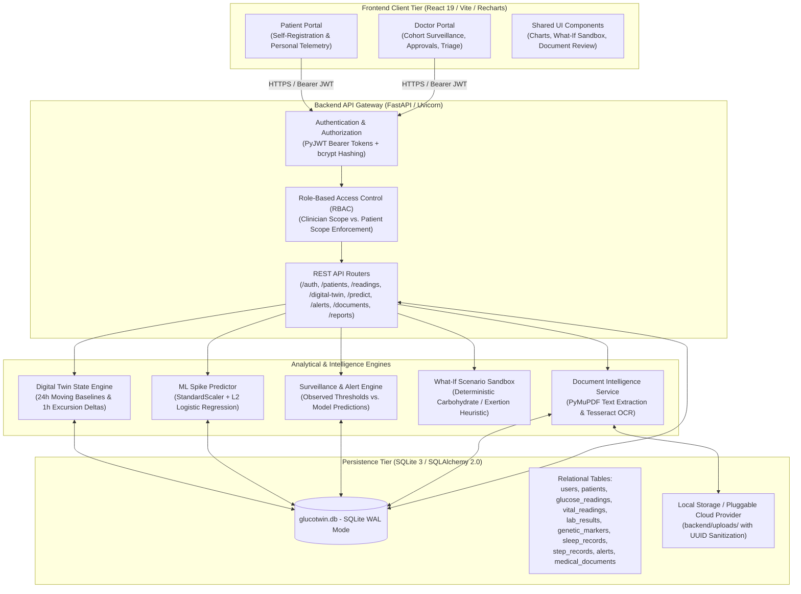

# GlucoTwin: An Intelligent Predictive Digital Twin for Proactive Glucose-Risk Monitoring

*Happiest Health Digital Twin Hackathon — Proof-of-Concept Submission*

[-success)](backend/tests)
[](frontend)
[](LICENSE)
[](https://gluco-twin-eta.vercel.app/)
[](https://gluco-twin.onrender.com)
[](https://gluco-twin.onrender.com/docs)
[](https://youtu.be/acc7yoSrYdQ)

> [!WARNING]
> **RESEARCH & HACKATHON PROOF-OF-CONCEPT NOTICE**  
> GlucoTwin is a software-only exploratory digital twin prototype built exclusively with **synthetic patient profiles**, **simulated physiological sensor streams**, and **synthetic clinical documents**. It is **not** a certified medical device, **not** clinically validated, and **must not** be used for clinical diagnosis, real-time medical monitoring, insulin titration, or medical treatment decisions.

---

## Submission Summary & Quick Links

| Submission Requirement | Verified Project Resource / Status | Direct Link |
|---|---|---|
| **Project Title** | GlucoTwin: An Intelligent Predictive Digital Twin for Proactive Glucose-Risk Monitoring | [Section 1](#1-project-overview) |
| **Project Type** | Software-only healthcare digital twin and AI/ML proof-of-concept | [Section 1](#1-project-overview) |
| **Hackathon** | Happiest Health Digital Twin Hackathon | [Header](#glucotwin-an-intelligent-predictive-digital-twin-for-proactive-glucose-risk-monitoring) |
| **Team Name & Members** | `yuvashrinarasimman25` (2 members: Yuvashri N, Tamilvanan G) | [Section 17](#17-team-details--institution) |
| **Institution** | Vel Tech High Tech Dr. Rangarajan Dr. Sakunthala Engineering College (AI&DS) | [Section 17](#17-team-details--institution) |
| **GitHub Repository** | Public open-source repository | [https://github.com/Yuvashri2516/Gluco-Twin](https://github.com/Yuvashri2516/Gluco-Twin) |
| **Live Frontend** | Deployed on Vercel Edge | [https://gluco-twin-eta.vercel.app/](https://gluco-twin-eta.vercel.app/) |
| **Live Backend** | Deployed on Render Web Service | [https://gluco-twin.onrender.com](https://gluco-twin.onrender.com/) |
| **API Documentation** | Interactive OpenAPI / Swagger UI | [https://gluco-twin.onrender.com/docs](https://gluco-twin.onrender.com/docs) |
| **Backend Health Probe** | Operational health check endpoint | [https://gluco-twin.onrender.com/health](https://gluco-twin.onrender.com/health) |
| **Architecture Diagram (PDF)** | Standalone vector graphic deliverable | [`submission/GlucoTwin_Architecture.pdf`](submission/GlucoTwin_Architecture.pdf) / [`docs/architecture.pdf`](docs/architecture.pdf) |
| **Architecture Diagram (PNG/SVG)** | Standalone raster & vector formats | [`submission/GlucoTwin_Architecture.png`](submission/GlucoTwin_Architecture.png) & [`.svg`](submission/GlucoTwin_Architecture.svg) |
| **Presentation Deck (PDF)** | 19-slide comprehensive project deck | [`submission/GlucoTwin_Presentation.pdf`](submission/GlucoTwin_Presentation.pdf) / [`docs/GlucoTwin_Hackathon_Presentation.pdf`](docs/GlucoTwin_Hackathon_Presentation.pdf) |
| **Presentation Deck (PPTX)** | Widescreen PowerPoint deliverable | [`submission/GlucoTwin_Presentation.pptx`](submission/GlucoTwin_Presentation.pptx) |
| **Demonstration Video** | 15–20 minute unlisted YouTube walkthrough | [Watch on YouTube](https://youtu.be/acc7yoSrYdQ) / [Section 14](#14-demonstration-video) |
| **Open-Source License** | Permissive MIT License | [`LICENSE`](LICENSE) |

---

## Table of Contents

1. [Project Overview](#1-project-overview)
2. [Problem Statement](#2-problem-statement)
3. [Project Objectives](#3-project-objectives)
4. [Healthcare Use Case](#4-healthcare-use-case)
5. [System Architecture](#5-system-architecture)
6. [Technical Stack](#6-technical-stack)
7. [AI/ML Model & Prediction Pipeline](#7-aiml-model--prediction-pipeline)
8. [Features & Implementation Status](#8-features--implementation-status)
9. [Clinical Risk Alert Engine & Triage Workflow](#9-clinical-risk-alert-engine--triage-workflow)
10. [Digital Twin State & Simulation Engine](#10-digital-twin-state--simulation-engine)
11. [What-If Counterfactual Sandbox](#11-what-if-counterfactual-sandbox)
12. [Data, Privacy & Ethical Considerations](#12-data-privacy--ethical-considerations)
13. [Repository Structure](#13-repository-structure)
14. [Demonstration Video](#14-demonstration-video)
15. [Local Setup & Execution](#15-local-setup--execution)
16. [Verification, Testing & Deployment Status](#16-verification-testing--deployment-status)
17. [Team Details & Institution](#17-team-details--institution)
18. [Future Enhancements](#18-future-enhancements)
19. [References](#19-references)
20. [Hackathon Submission Checklist](#20-hackathon-submission-checklist)

---

## 1. Project Overview

**GlucoTwin** is a software-only healthcare digital twin and machine-learning proof of concept developed for the **Happiest Health Digital Twin Hackathon**. The project investigates how a virtual representation of an individual patient—combining synthetic electronic health records (EHR), longitudinal laboratory panels, genetic susceptibility markers, and simulated continuous physiological readings—can be used to monitor changing metabolic states and evaluate glucose-related risk trajectories.

In standard diabetes outpatient care, patient data is collected discontinuously through isolated clinic visits and reactive threshold alarms from Continuous Glucose Monitors (CGMs). GlucoTwin demonstrates an integrated software platform where:
- A **Patient Digital Twin** continuously synchronizes multi-vital time-series streams (continuous glucose, heart rate, heart-rate variability, sleep architecture, and activity step intervals) against historical EHR context.
- An **AI/ML Prediction Pipeline** evaluates forward glucose-spike risk ($G \ge 180\text{ mg/dL}$ within a forward 120-minute window) using transparent linear feature contributions.
- A **Dual-Source Alert Surveillance Engine** clearly separates observed physiological breaches from predictive warnings to minimize alert fatigue.
- A **Role-Based Web Dashboard** provides authenticated portals for patients and clinicians, complete with doctor-approval controls, clinical document extraction, and an interactive counterfactual "What-If" simulation sandbox.

---

## 2. Problem Statement

### 2.1 Fragmented Patient Information
Modern healthcare systems typically isolate historical clinical records from continuous physiological monitoring. Electronic Health Records (EHR)—including baseline HbA1c, lipid profiles, chronic diagnoses, renal biomarkers, and genetic predispositions—reside in hospital databases, while Continuous Glucose Monitors (CGMs) and wearable sensors store data in proprietary manufacturer clouds. Consequently, care teams evaluate real-time sensor streams without immediate access to the patient's underlying metabolic context.

### 2.2 The Limitations of Reactive Monitoring
Commercial glucose monitoring devices operate predominantly on **reactive threshold alerting**: an audible alarm triggers only *after* an acute excursion has already taken place (e.g., when blood glucose falls below $70\text{ mg/dL}$ for hypoglycemia or climbs above $180\text{ mg/dL}$ or $250\text{ mg/dL}$ for hyperglycemia). For insulin-dependent individuals and brittle diabetes cohorts, this leaves a dangerously narrow window for intervention. Furthermore, autonomic stress indicators—such as acute heart-rate elevation or depressed heart-rate variability (HRV)—often accompany glycemic distress but are rarely analyzed alongside glucose curves.

### 2.3 The Need for Patient-Specific Health-State Representation
No two patients process carbohydrates, stress, or exercise identically. Insulin sensitivity varies across diabetes subtypes (Type 1, Type 2, Gestational, Pre-diabetes) and fluctuates based on body mass index, sleep duration, disease duration, and circadian rhythm. A unified virtual patient model—a **digital twin**—is required to compute rolling moving baselines, track short-term excursion deltas, and maintain a stateful representation of individual physiological dynamics.

### 2.4 The Value of Predictive Analytics and Understandable Alerts
Moving from reactive threshold detection to proactive surveillance requires predictive models capable of estimating future excursion likelihood before spikes occur. However, "black-box" predictions create clinical distrust. Clinicians and patients require interpretable alerts with explicit feature contributions showing *why* a risk score changed (e.g., rapid glycemic velocity, elevated heart rate, or circadian timing).

### 2.5 The Role of Digital Twins in Proactive Healthcare Research
Digital twins offer a software testbed where simulated counterfactual scenarios (e.g., meal intake versus physical exertion) can be explored safely without placing patients at physical risk. While physical medical devices require years of clinical trials, software-based digital twin prototypes allow researchers to explore data fusion paradigms, human-in-the-loop workflows, and ethical boundaries in simulated environments.

> [!NOTE]
> *Scope Clarification:* GlucoTwin does not claim to eliminate all clinical diabetes challenges or independently improve patient medical outcomes. It serves as an exploratory engineering prototype illustrating digital twin concepts.

---

## 3. Project Objectives

1. **Build a Software-Only Virtual Patient Representation:** Develop a stateful digital twin profile that aggregates demographic baselines, longitudinal medical records, and dynamic physiological time-series.
2. **Combine Synthetic EHR and Physiological Readings:** Unify structured lab panels (HbA1c, Fasting Glucose, Lipids), historical diagnoses, genetic susceptibility markers, continuous glucose (CGM), heart rate (HR), heart-rate variability (HRV), sleep stages, and step counts.
3. **Represent Changes in Simulated Health States:** Compute continuous 24-hour baseline averages versus 1-hour excursion deltas ($\Delta G_{1h}, \Delta HR_{1h}, \Delta HRV_{1h}$) and reading density metrics.
4. **Explore Glucose-Risk Prediction:** Train and evaluate an interpretable baseline classification pipeline designed to forecast whether glucose will reach or exceed $180\text{ mg/dL}$ within a forward 120-minute window.
5. **Present Information Through an Accessible Web Dashboard:** Deliver a responsive, role-based single-page application tailored for clinicians and patients.
6. **Provide Secure, Role-Based Access Control:** Ensure clinicians can oversee assigned cohorts while patients remain isolated strictly to their personal records.
7. **Explain Risk Assessments Transparently:** Break down model risk scores into linear feature contribution weights (Explainable AI / XAI) so users understand which variables drive predictions.
8. **Explore What-If Counterfactual Simulations:** Provide an interactive educational sandbox illustrating estimated glycemic influx from carbohydrates and clearance from physical activity.
9. **Demonstrate a Foundation for Future Digital Twin Research:** Establish an open, reproducible, well-tested architecture for future multimodal clinical modeling.

---

## 4. Healthcare Use Case

### 4.1 Narrative Patient Scenario
Consider **Elena Rostova** (represented in the application as Patient #1), a 52-year-old female diagnosed with Type 2 Diabetes for 8 years, with documented comorbidities of Essential Hypertension, Dyslipidemia, and Mild Diabetic Neuropathy. Her synthetic baseline shows an HbA1c of $7.8\%$ and a calculated BMI of $28.8\text{ kg/m}^2$.

Elena wears a continuous glucose monitor and an autonomic wearable sensor transmitting readings at 15-minute intervals. During a typical morning:
1. **Permitted Information Retrieval:** The attending clinician logs into the Doctor Portal and opens Elena's profile. Strict server-side authorization verifies the doctor's credentials and care scope before returning Elena's EHR, lab history, and telemetry.
2. **Historical & Recent Telemetry Display:** The clinician views Elena's synchronized continuous glucose curve alongside heart rate (HR) and heart-rate variability (HRV) across 24-hour, 48-hour, or 7-day monitoring windows.
3. **Virtual Patient State Synchronization:** The digital twin engine aggregates Elena's rolling 24-hour mean glucose ($142.4\text{ mg/dL}$), compares it with her recent 1-hour excursion delta ($+28.5\text{ mg/dL}$), assesses telemetry freshness, and evaluates sleep efficiency ($85.7\%$).
4. **Inference Execution:** The 14-feature prediction pipeline evaluates Elena's latest readings, glycemic rate of change, heart rate, and circadian timing. If the model identifies an elevated probability ($\ge 0.50$) of glucose exceeding $180\text{ mg/dL}$ within the next 120 minutes, a prospective risk score is returned.
5. **Risk Assessment & Explainability:** The dashboard displays the risk score accompanied by an explainability breakdown, indicating that a rising 1-hour glucose trend ($+0.42\text{ mg/dL/min}$) and elevated heart rate are the primary factors elevating risk.
6. **Alert Notification & Triage:** An active alert is created in the surveillance center. The clinician can review the alert, examine the trigger value, acknowledge it, and record clinical encounter notes.
7. **What-If Exploration:** The clinician or patient uses the counterfactual sandbox to model scenario outcomes: for instance, evaluating how a proposed 30-minute post-meal walk might offset an anticipated 50g carbohydrate lunch.

> [!IMPORTANT]
> All patient records, laboratory panels, genetic alleles, and sensor streams are **clinically modeled synthetic data**. The system does not connect to real wearable IoT devices and is not certified to replace healthcare professionals or clinical diagnostic systems.

---

## 5. System Architecture

GlucoTwin employs a decoupled, multi-tier architecture separating the reactive client, stateless API routing, analytical intelligence engines, and persistent relational storage.



### Architecture Data Flow Summary
1. **User Authentication:** Clients authenticate via `/api/auth/login`. Passwords are verified against salted bcrypt hashes. A signed JWT containing user identity and role (`clinician` or `patient`) is issued.
2. **Access-Controlled Requests:** Subsequent REST requests include the `Authorization: Bearer <token>` header. Server-side dependencies enforce role permissions and patient-level data isolation.
3. **Telemetry & Twin Aggregation:** The Digital Twin engine queries windowed readings from `glucose_readings` and `vital_readings` via SQLAlchemy, computing 24-hour baselines, 1-hour rates of change ($\text{mg/dL/min}$), and reading density.
4. **Machine Learning Inference:** When requested via `POST /api/predict/spike`, the system extracts 14 leak-free features from historical readings ($t \le T$), scales them with the serialized `StandardScaler`, and executes logistic regression inference.
5. **Alert Surveillance:** The alert engine evaluates new readings against clinical threshold bounds (e.g., hypoglycemia $< 70\text{ mg/dL}$, severe hyperglycemia $\ge 250\text{ mg/dL}$) and prediction scores, writing deduplicated alerts to SQLite.

#### Architecture Deliverable Files
- **High-Resolution Vector PDF:** [`submission/GlucoTwin_Architecture.pdf`](submission/GlucoTwin_Architecture.pdf) (Mirror: [`docs/architecture.pdf`](docs/architecture.pdf))
- **High-Resolution PNG Graphic:** [`submission/GlucoTwin_Architecture.png`](submission/GlucoTwin_Architecture.png)
- **Scalable Vector Graphics (SVG):** [`submission/GlucoTwin_Architecture.svg`](submission/GlucoTwin_Architecture.svg)
- **Presentation Integration:** Slide 7 of [`submission/GlucoTwin_Presentation.pptx`](submission/GlucoTwin_Presentation.pptx)

---

## 6. Technical Stack

The GlucoTwin codebase was verified by inspecting all package manifests (`frontend/package.json`, `backend/requirements.txt`, root `requirements.txt`) and active source files:

| Layer / Domain | Technology | Exact Version / Spec | Purpose & Implementation Verification |
|---|---|---|---|
| **Frontend Framework** | **React** | `^19.2.8` | Component-based clinician and patient single-page application. |
| **Frontend Build Tool** | **Vite** | `^8.3.0` | Fast local development server and optimized rollup production bundling (~7.1s build). |
| **Frontend Language** | **JavaScript (ES Modules)** | ECMAScript 2022+ | Client-side reactive state management and API communication. |
| **Styling & Design System** | **Vanilla CSS** | Custom CSS3 | Modern dark medical tech aesthetic (`#0b1120`, `#1e293b`, `#38bdf8`), glassmorphism, responsive flex/grid layouts. Avoids heavy CSS framework overhead. |
| **Data Visualization** | **Recharts** | `^3.10.1` | Time-series charts for continuous glucose (CGM), dual vitals (HR/HRV), sleep hypnograms, and step intervals. |
| **UI Iconography** | **Lucide React** | `^1.55.0` | Accessible medical-grade icons for alerts, status indicators, and navigation. |
| **Frontend Linter** | **Oxlint** | `^1.81.0` | High-performance Rust-based JavaScript/JSX linter (verified 0 errors). |
| **Backend Framework** | **Python / FastAPI** | Python `3.10+` (FastAPI `>=0.110,<1.0`) | High-throughput asynchronous REST API with automatic OpenAPI documentation. |
| **ASGI Web Server** | **Uvicorn** | `uvicorn[standard]>=0.29,<1.0` | Production ASGI web server running FastAPI. |
| **Database & ORM** | **SQLite 3 & SQLAlchemy** | `sqlalchemy>=2.0,<3.0` | Transactional relational storage with WAL mode, parameterized queries, and idempotent unique constraints. |
| **Data Validation** | **Pydantic** | `pydantic>=2.0,<3.0` | Strict bidirectional schema validation for multi-vital telemetry, lab results, and auth payloads. |
| **Machine Learning** | **Scikit-learn** | `scikit-learn>=1.4,<2.0` | Pipeline containing `StandardScaler` and regularized `LogisticRegression`. |
| **Serialization** | **Joblib** | Bundled / `joblib` | Serialization of trained ML pipeline artifacts. |
| **Numerical Processing** | **NumPy & Pandas** | `numpy>=1.26,<3.0`, `pandas>=2.2,<3.0` | Numerical calculations, glucose simulation waves, and tabular dataset parsing. |
| **Authentication & Security** | **bcrypt & PyJWT** | `bcrypt>=4.0.0`, `PyJWT>=2.8.0` | Salted password hashing (cost factor 12) and HMAC-SHA256 JWT access tokens. |
| **Document Intelligence** | **PyMuPDF, openpyxl, pytesseract, Pillow** | `PyMuPDF>=1.24.0`, `openpyxl>=3.1.0`, `pytesseract>=0.3.10`, `Pillow>=10.0.0` | Local embedded PDF text parsing, Excel parsing, and local OCR fallback for medical reports. |
| **Automated Testing** | **pytest & pytest-asyncio** | Standard pytest | 131 automated unit and integration tests executing against in-memory SQLite databases. |
| **Hosting & Deployment** | **Vercel & Render** | Cloud Edge / Containers | Frontend hosted on Vercel Edge; backend hosted as a Render web service. |

---

## 7. AI/ML Model & Prediction Pipeline

### 7.1 Algorithm Selection & Rationale
GlucoTwin utilizes a regularized linear model: **`StandardScaler` + `LogisticRegression(penalty='l2', C=1.0, solver='lbfgs')`**.
- **Clinical Interpretability:** In healthcare risk surveillance, black-box architectures (e.g., deep neural networks) obscure feature influence. Logistic regression provides direct, mathematically transparent log-odds weights ($\beta_i$), allowing the application to display exact linear feature contributions to clinicians.
- **Overfitting Resistance:** Given the small-cohort proof-of-concept dataset, an $L_2$ Ridge penalty prevents any single feature from dominating predictions.
- **Low-Latency Inference:** Linear model evaluation requires minimal CPU operations, executing in under 5 milliseconds on standard commodity hardware.

### 7.2 Purpose of Feature Scaling
Input features have vastly different numeric magnitudes: glucose values range from $40$ to $400\text{ mg/dL}$, heart rate spans $45$ to $160\text{ bpm}$, while circadian sine/cosine terms oscillate between $-1.0$ and $+1.0$. Without standardization, the optimization solver would artificially penalize features with smaller numeric variances. `StandardScaler` standardizes each feature to zero mean and unit variance ($\mu = 0, \sigma = 1$). To prevent temporal data leakage, `StandardScaler` is fitted strictly on historical training data.

### 7.3 Model Input Features (14 Dimensions)
The model consumes an exact 14-dimensional feature vector extracted from readings strictly preceding the forecast time $t \le T$:

| # | Feature Name in Pipeline | Description | Typical Unit / Range |
|---|---|---|---|
| 1 | `curr_glucose` | Most recent glucose reading at time $T$ | $40.0 – 400.0\text{ mg/dL}$ |
| 2 | `mean_glucose_1h` | Rolling 1-hour average glucose | $\text{mg/dL}$ |
| 3 | `std_glucose_1h` | Rolling 1-hour glucose standard deviation | $\text{mg/dL}$ |
| 4 | `slope_glucose_1h` | Linear slope / rate of change over the last hour | $\text{mg/dL per minute}$ |
| 5 | `curr_hr` | Most recent heart rate reading at time $T$ | $45.0 – 160.0\text{ bpm}$ |
| 6 | `curr_hrv` | Most recent heart-rate variability (RMSSD) at time $T$ | $15.0 – 110.0\text{ ms}$ |
| 7 | `mean_hr_1h` | Rolling 1-hour average heart rate | $\text{bpm}$ |
| 8 | `mean_hrv_1h` | Rolling 1-hour average HRV | $\text{ms}$ |
| 9 | `circadian_sin` | Cyclical time-of-day sine encoding: $\sin(2\pi \cdot \text{hour} / 24)$ | $[-1.0, +1.0]$ |
| 10 | `circadian_cos` | Cyclical time-of-day cosine encoding: $\cos(2\pi \cdot \text{hour} / 24)$ | $[-1.0, +1.0]$ |
| 11 | `age` | Patient chronological age | Years ($1 – 120$) |
| 12 | `years_diagnosis` | Duration of diagnosed diabetes | Years |
| 13 | `is_type1` | Binary indicator ($1$ if Type 1 Diabetes, else $0$) | $\{0, 1\}$ |
| 14 | `is_prediabetes` | Binary indicator ($1$ if Pre-diabetes, else $0$) | $\{0, 1\}$ |

### 7.4 Prediction Target & Horizon
- **Target Event:** Binary classification ($y \in \{0, 1\}$). Will the patient's glucose level reach or exceed **$180.0\text{ mg/dL}$** at any point within the forward **120-minute window** ($t \in (T, T + 120\text{ min}]$)?
- **Lookback Window:** Historical readings within $t \in [T - 60\text{ min}, T]$.
- **Leakage Prevention Buffer:** An 8-step (2-hour) purge gap is enforced between chronological training and test partitions to ensure no overlapping 120-minute forward target windows contaminate evaluation.

### 7.5 Verified Model Metrics (From Serialized Artifact `model_metadata.json`)
The following metrics reflect the exact values stored in [`backend/app/ml/artifacts/model_metadata.json`](backend/app/ml/artifacts/model_metadata.json), trained via [`backend/app/ml/train.py`](backend/app/ml/train.py) and reproduced via [`scripts/reproduce_ml_metrics.py`](scripts/reproduce_ml_metrics.py):

| Metric | Model Performance | Baseline Comparison | Clinical Interpretation |
|---|:---:|:---:|---|
| **Total Usable Samples** | 1,400 samples | — | Derived from 5 synthetic patient time-series. |
| **Training Partition** | 1,005 samples (39.5% positive) | — | Chronologically prior time intervals. |
| **Purged Gap Buffer** | 40 samples (8 steps) | — | Excluded to eliminate forward lookahead overlap. |
| **Evaluation Test Set** | 355 samples (37.5% positive) | — | Held-out forward chronological time intervals. |
| **Accuracy** | **60.28%** (`0.6028`) | 62.54% (Majority Baseline) | Balanced performance on imbalanced event distribution. |
| **Precision** | **47.37%** (`0.4737`) | 0.00% (Majority Baseline) | Probability that a predicted spike truly breaches $180\text{ mg/dL}$. |
| **Recall (Sensitivity)** | **54.14%** (`0.5414`) | 0.00% (Majority Baseline) | Proportion of true 120-minute spikes correctly caught. |
| **F1-Score** | **0.5053** | 0.0000 (Majority Baseline) | Harmonic mean of precision and recall. |
| **ROC-AUC** | **0.7046** | 0.5000 (Random Guess) | Area under the Receiver Operating Characteristic curve. |
| **Confusion Matrix** | $\text{TN}=142, \, \text{FP}=80$ <br/> $\text{FN}=61, \, \text{TP}=72$ | — | Total test samples = 355. |

### 7.6 Cross-Patient Generalization Boundary
When evaluated using Leave-One-Patient-Out cross-validation (training on 4 patient profiles and testing on the 5th unseen profile):
- Unseen-patient ROC-AUC averages **~0.52** (near random).
- **Scientific Rationale:** With only 5 synthetic patient profiles in the seed dataset, individual metabolic differences (insulin sensitivity, age, body mass) confound population-level generalization.
- **Design Conclusion:** **GlucoTwin's ML model operates as a personalized trajectory surveillance model, not a universal population screening tool.** In real-world deployment, personalized calibration on an individual's historical baseline would be required.

### 7.7 Prediction Delivery to the Frontend & Safety Guardrail
- The frontend calls `POST /api/predict/spike` with `patient_id` and optional `as_of_timestamp`.
- **Safety Guardrail:** If a newly registered or un-instrumented patient has fewer than 4 readings (< 1 hour of telemetry), the backend returns `status: "insufficient_history"` with an explicit message: *"Insufficient continuous telemetry (< 1 hour). The prediction model requires historical trend context to evaluate forward risk."* The UI displays an informative status rather than generating uncalibrated predictions.

---

## 8. Features & Implementation Status

Every feature in the repository was inspected across backend routers, database schemas, and frontend React components. Implementation statuses are documented below:

| Feature | Description | Status |
|---|---|:---:|
| **Patient Registration & Login** | Public self-registration for patients (`/api/auth/register-patient`), role assignment, bcrypt hashing, and authenticated login. | **Implemented and verified** |
| **Doctor Registration & Login** | Registration request for clinicians (`/api/auth/register-doctor`), medical license capture, pending approval state. | **Implemented and verified** |
| **Authentication & Role-Based Access** | PyJWT access tokens, server-side role validation (`clinician` vs `patient`), password hashing with salt. | **Implemented and verified** |
| **Doctor Account Approval Workflow** | Active clinicians review, approve, or reject pending doctor accounts (`/api/auth/doctor-requests`). | **Implemented and verified** |
| **Care-Scope Patient Assignment** | Clinicians can be assigned specific patients; unassigned patients are restricted (`DoctorPatientAssignment`). | **Implemented and verified** |
| **Patient Dashboard** | Dedicated personal portal displaying individual continuous glucose, autonomic vitals, sleep, and medical history. | **Implemented and verified** |
| **Doctor Dashboard** | Cohort surveillance dashboard with patient switching, multi-vital telemetry, and triage tools. | **Implemented and verified** |
| **Patient-Specific Health Records** | EHR profile with age, gender, subtype, height, weight, computed BMI, diagnoses, and lab history. | **Implemented and verified** |
| **Continuous Glucose Telemetry & History** | Time-series visualization with selectable 24h, 48h, and 7d windows and in-range statistics. | **Implemented and verified** |
| **Glucose-Risk Prediction Pipeline** | 14-feature logistic regression forecasting 120-minute spike risk ($\ge 180\text{ mg/dL}$) with linear XAI weights. | **Implemented and verified** |
| **Simulated Heart-Rate & HRV Telemetry** | Synchronized 15-minute heart rate (bpm) and heart-rate variability (RMSSD, ms) autonomic tracking. | **Implemented and verified** |
| **Sleep Architecture Information** | Polysomnographic sleep stages (Deep, Light, REM, Awake), total sleep duration, and efficiency metrics. | **Implemented and verified** |
| **Physical Activity Telemetry** | 15-minute interval step tracking paired with daily cumulative totals. | **Implemented and verified** |
| **Clinical Risk Alert Engine** | Dual-source alert generation (observed breaches vs model predictions) with `active` $\rightarrow$ `acknowledged` $\rightarrow$ `resolved` lifecycle. | **Implemented and verified** |
| **Simulated Clinician Pager** | In-dashboard alert escalation log demonstrating notification dispatch to on-call hospital staff (local simulation). | **Implemented and verified** |
| **What-If Simulation Sandbox** | Interactive scenario calculator modeling postprandial carbohydrate impacts and physical exertion offsets. | **Implemented and verified** |
| **Digital Twin State & Feed Simulation** | Stateful virtual profile with moving baselines, deltas, and an interactive `+15m` sensor feed advancement button. | **Implemented and verified** |
| **Manual Medical Ingestion** | Clinician forms for spot glucose (`mg/dL` / `mmol/L` auto-conversion), vitals, labs, and clinical encounter notes. | **Implemented and verified** |
| **Medical Document Upload & Storage** | Ingestion of PDF, PNG, JPG, CSV, and XLSX (up to 15MB) with UUID-sanitized filenames and traversal defense. | **Implemented and verified** |
| **Document Intelligence & Entity Extraction** | Local PyMuPDF text parsing, Tesseract OCR for image reports, tabular CSV/XLSX preview, and draft review before saving to EHR. | **Implemented and verified** |
| **Clinical Health Report Generation** | Printable / exportable summary report aggregating patient profile, active alerts, and recent vitals. | **Implemented and verified** |
| **Physical IoT Device Integration** | Hardware integration with physical continuous glucose sensors or Bluetooth wearable monitors. | **Not implemented** (Software-only prototype) |
| **External SMS / Pager Gateway** | Direct cellular SMS, SMTP email, or hospital paging network dispatch. | **Planned** (Simulated locally in-app) |
| **Cloud Object Storage (AWS S3 / GCS)** | Production object storage integration (abstract interface implemented in `storage.py`). | **Partially implemented** (Local storage active; S3 interface implemented) |

---

## 9. Clinical Risk Alert Engine & Triage Workflow

GlucoTwin explicitly separates alerts into two distinct clinical classes to eliminate ambiguity:

```
                          ┌────────────────────────┐
                          │ Incoming Telemetry / ML│
                          └───────────┬────────────┘
                                      │
                 ┌────────────────────┴────────────────────┐
                 │                                         │
                 ▼                                         ▼
   [Observed Reading Check]                   [Model Prediction Check]
   - Severe Hypoglycemia (<54 mg/dL)          - 120-min Spike Risk (p >= 0.50)
   - Hypoglycemia (<70 mg/dL)                 - Glycemic Velocity Warning
   - Hyperglycemia (>=180 mg/dL)              - Insufficient History Guard
   - Severe Hyperglycemia (>=250 mg/dL)
   - Autonomic Distress (HR>=100 & HRV<=25)
                 │                                         │
                 └────────────────────┬────────────────────┘
                                      │
                                      ▼
                        [Deduplication Evaluation]
                        Unique constraint in SQLite:
                        obs:{patient_id}:{type}:{reading_id}
                        pred:{patient_id}:{timestamp_minute}
                                      │
                                      ▼
                        [Alert Lifecycle State]
                     ACTIVE ──> ACKNOWLEDGED ──> RESOLVED
```

### 9.1 Alert Classification
1. **Observed-Reading Alerts (`source: observed_reading`):**
   - **Severe Hypoglycemia:** $< 54.0\text{ mg/dL}$ (Severity: `critical`)
   - **Hypoglycemia:** $< 70.0\text{ mg/dL}$ (Severity: `warning`)
   - **Hyperglycemia:** $\ge 180.0\text{ mg/dL}$ (Severity: `warning`)
   - **Severe Hyperglycemia:** $\ge 250.0\text{ mg/dL}$ (Severity: `critical`)
   - **Autonomic Distress:** $\text{HR} \ge 100\text{ bpm}$ and $\text{HRV} \le 25\text{ ms}$ simultaneously (Severity: `warning`)
2. **Model-Predicted Alerts (`source: experimental_prediction`):**
   - **Predicted Hyperglycemic Excursion:** Risk score $p \ge 0.50$ (Severity: `warning`)

### 9.2 Lifecycle & Idempotence
- **State Machine:** `active` $\longrightarrow$ `acknowledged` $\longrightarrow$ `resolved`.
- **Database Deduplication:** Enforces unique constraint on `Alert.dedup_key` in SQLite:
  - Observed alerts: `obs:{patient_id}:{alert_type}:{reading_id}`
  - Predictive alerts: `pred:{patient_id}:{timestamp_minute_slug}`
- **Simulated Clinician Pager:** High-severity alerts appear in an in-dashboard triage center demonstrating dispatch to on-call hospital endocrinologists and diabetes nurse educators.

---

## 10. Digital Twin State & Simulation Engine

The digital twin engine maintains a stateful virtual profile for each patient:

### 10.1 Computed Twin Metrics
- **24-Hour Baseline Mean:** Running average glucose over the prior 24 hours.
- **1-Hour Excursion Delta ($\Delta G_{1h}$):** Net change in glucose over the past 60 minutes ($G_T - G_{T-60m}$).
- **Glycemic Trend Slope:** Rate of change expressed in $\text{mg/dL per minute}$.
- **Autonomic Deltas ($\Delta HR_{1h}, \Delta HRV_{1h}$):** Rolling 1-hour changes in cardiac stress markers.
- **Data Freshness & Coverage:** Tracks time elapsed since the last reading and evaluates whether telemetry density is sufficient for reliable surveillance.

### 10.2 Demonstrable Sensor Feed Simulation (+15m Epoch)
To demonstrate digital twin updates in real-time without physical wearables:
1. The user navigates to the **Digital Twin Panel** or clicks the **"⚡ Advance Simulation (+15m)"** button.
2. The frontend sends a `POST /api/digital-twin/simulate-feed` request.
3. The backend generates a synchronized 15-minute epoch (glucose, HR, HRV, step interval), advances the virtual timeline, and commits records to SQLite.
4. The surveillance engine re-evaluates clinical thresholds, generating new alerts if warranted.
5. The digital twin state recomputes baselines and returns updated vectors to the UI immediately.

---

## 11. What-If Counterfactual Sandbox

The What-If Sandbox provides a deterministic educational calculator anchored to the patient's current baseline glucose:

$$\Delta G_{\text{carbs}} = \Delta C \times \left(0.40 \times \frac{70}{\text{weight\_kg}} \times K_{\text{type}}\right)$$

Where the subtype sensitivity factor $K_{\text{type}}$ is:
- **Type 1 Diabetes:** $1.30$
- **Type 2 Diabetes:** $1.15$
- **Pre-diabetic:** $0.90$
- **Healthy / Other:** $0.80$

Physical activity clearance is calculated as:

$$\Delta G_{\text{activity}} = -\Delta A \times 0.75\text{ mg/dL per minute of moderate exercise}$$

The projected postprandial scenario glucose is clamped to physiological bounds:

$$G_{\text{scenario}} = \max\left(40.0, \, G_{\text{baseline}} + \Delta G_{\text{carbs}} + \Delta G_{\text{activity}}\right)$$

> [!NOTE]
> The sandbox is explicitly labeled **"SIMULATED — NOT A CLINICAL PREDICTION"** to reinforce that heuristic formulas are educational models and cannot substitute for clinical pharmacokinetic insulin dosing.

---

## 12. Data, Privacy & Ethical Considerations

### 12.1 Synthetic Data Declaration
GlucoTwin operates entirely on **synthetic patient profiles** and **simulated physiological time-series**. No Protected Health Information (PHI), real patient records, or physical IoT sensor streams are stored or processed.

### 12.2 Ethical & Clinical Limitations
- **Not a Medical Device:** GlucoTwin has not undergone clinical trials, FDA 510(k) clearance, CE mark certification, or independent clinical validation.
- **Non-Diagnostic:** Risk scores and what-if calculations must not be used for medical diagnoses, medication changes, or insulin titration.
- **Synthetic Distribution Shift:** Models trained on synthetic data do not capture real-world clinical confounders (e.g., gastroparesis, systemic infection, acute psychological stress, medication non-adherence).

### 12.3 Privacy & Security Architecture
- **Cryptographic Hashing:** Passwords are never stored in plaintext; salted bcrypt hashes (12 rounds) are used.
- **Token Security:** Authentication tokens use HMAC-SHA256 JWTs with server-side expiration.
- **Local Document Processing:** Document parsing (PyMuPDF) and OCR (Tesseract) execute locally on the host machine without transmitting medical files to third-party generative AI APIs.
- **Regulatory Clarification:** The project does not claim certified compliance with HIPAA, GDPR, or ISO 27001. A production deployment handling real patient data would require independent penetration testing, encrypted data-at-rest volumes, Business Associate Agreements (BAA), and comprehensive regulatory audits.

---

## 13. Repository Structure

```
Gluco-Twin/
├── .gitignore                          # Git exclusions (venv, node_modules, pycache, dist)
├── LICENSE                             # Open-source MIT License
├── README.md                           # Comprehensive project documentation (this file)
├── requirements.txt                    # Root Python dependencies mirror
│
├── backend/                            # FastAPI Backend Service
│   ├── .env.example                    # Template for environment configuration
│   ├── glucotwin.db                    # Active SQLite database with seeded synthetic cohorts
│   ├── requirements.txt                # Backend Python package requirements
│   ├── app/
│   │   ├── __init__.py
│   │   ├── alerts_engine.py            # Threshold evaluator, dedup keys, state lifecycle
│   │   ├── auth.py                     # bcrypt hashing, JWT issuance, RBAC dependencies
│   │   ├── database.py                 # SQLAlchemy engine, session maker, base model
│   │   ├── main.py                     # FastAPI entry point, CORS config, lifecycle hooks
│   │   ├── models.py                   # SQLAlchemy ORM models (12 relational tables)
│   │   ├── schemas.py                  # Pydantic v2 validation models
│   │   ├── seed.py                     # Synthetic patient profiles & physiological time-series
│   │   ├── ml/                         # Machine learning pipeline package
│   │   │   ├── __init__.py
│   │   │   ├── pipeline.py             # Feature engineering, dataset construction, inference
│   │   │   ├── train.py                # Model training CLI with chronological holdout split
│   │   │   └── artifacts/
│   │   │       ├── glucose_spike_model.joblib   # Serialized StandardScaler + LogisticRegression
│   │   │       └── model_metadata.json          # Metrics, coefficients, features, limitations
│   │   ├── routers/                    # Modular API route controllers
│   │   │   ├── __init__.py
│   │   │   ├── alerts.py               # List, acknowledge, resolve alerts
│   │   │   ├── auth.py                 # Login, patient/doctor registration, approvals
│   │   │   ├── documents.py            # File uploads, PyMuPDF/OCR parsing, EHR confirmation
│   │   │   ├── patients.py             # Patient CRUD, longitudinal lab panels, genetics
│   │   │   ├── predictions.py          # ML spike prediction endpoint & feature explanations
│   │   │   ├── readings.py             # Glucose, vitals, sleep, and step count streams
│   │   │   ├── reports.py              # Patient clinical report export endpoint
│   │   │   └── twin.py                 # Digital twin state vector & +15m feed simulation
│   │   └── services/
│   │       ├── document_parser.py      # PDF, OCR, and Excel parsing logic
│   │       └── storage.py              # Abstract storage provider (local disk & S3 interface)
│   ├── tests/                          # Automated backend test suite (14 test modules)
│   │   ├── conftest.py                 # Pytest fixtures with in-memory SQLite isolation
│   │   ├── test_alerts_engine.py
│   │   ├── test_auth_and_authorization.py
│   │   ├── test_feature_engineering.py
│   │   ├── test_label_construction.py
│   │   ├── test_multimodal_ehr_and_streams.py
│   │   ├── test_patient_and_doctor_portals.py
│   │   ├── test_patient_mgmt_and_document_intelligence.py
│   │   ├── test_persistent_storage.py
│   │   ├── test_phase3_digital_twin.py
│   │   ├── test_phase4_integration.py
│   │   ├── test_prediction_api.py
│   │   └── test_readings_api.py
│   └── uploads/                        # Local file upload directory (UUID-prefixed)
│
├── frontend/                           # React 19 / Vite Frontend SPA
│   ├── .env.example                    # Frontend environment template
│   ├── index.html                      # HTML5 entry template
│   ├── package.json                    # Frontend dependencies (React, Vite, Recharts, Lucide)
│   ├── vite.config.js                  # Vite configuration & dev server proxy
│   └── src/
│       ├── App.css                     # Design system styles (dark medical theme)
│       ├── App.jsx                     # Root application coordinator & tab router
│       ├── main.jsx                    # React DOM entry point
│       ├── api/
│       │   └── client.js               # Centralized API client with JWT interceptor
│       └── components/                 # Reusable UI component modules
│           ├── AccountEntryScreen.jsx  # Unified portal login & registration UI
│           ├── AddReadingPanel.jsx     # Manual entry for glucose, vitals, labs, diagnoses
│           ├── AlertsPanel.jsx         # Clinical surveillance center & triage pager
│           ├── DigitalTwinPanel.jsx    # Twin state vector & +15m feed simulator
│           ├── DoctorApprovalModal.jsx # Clinician doctor-request management modal
│           ├── GlucoseChart.jsx        # Recharts continuous glucose curve
│           ├── MedicalDocumentsPanel.jsx # File dropzone & uploaded document table
│           ├── MonitoringCards.jsx     # Key vital metric cards (glucose, HR, HRV)
│           ├── PatientEhrHistory.jsx   # EHR demographics, diagnoses, labs, genetics
│           ├── PatientModal.jsx        # Patient registration & profile editing modal
│           ├── PatientOverview.jsx     # Cohort selection card grid
│           ├── PredictionsPanel.jsx    # ML spike risk gauge & linear XAI contributions
│           ├── ReportPanel.jsx         # Clinical summary report view
│           ├── ReviewExtractedDataPanel.jsx # Candidate draft review before saving to EHR
│           ├── Sidebar.jsx             # Role-aware sidebar navigation
│           ├── SleepActivityPanel.jsx  # Sleep hypnogram & 15m step intervals
│           ├── Topbar.jsx              # Navigation header, patient picker, user status
│           ├── VitalsChart.jsx         # Synchronized HR and HRV time-series chart
│           └── WhatIfSimulation.jsx    # Counterfactual meal / exercise sandbox
│
├── docs/                               # Architectural & Technical Documentation
│   ├── API_INTEGRATION.md              # REST endpoint contracts & payload schemas
│   ├── architecture.pdf                # Mirror of system architecture diagram
│   ├── DEMO_GUIDE.md                   # 5-minute presentation script & live walk-through
│   ├── FIGMA_DESIGN_NOTES.md           # UI design tokens, color palette, typography
│   ├── FRONTEND_ARCHITECTURE.md        # State management & component hierarchy
│   ├── GlucoTwin_Hackathon_Presentation.pdf # Presentation deck mirror
│   ├── ML_EVALUATION_REPORT.md         # Detailed machine learning evaluation notes
│   ├── PHASE_3_DIGITAL_TWIN_REPORT.md  # Digital twin engine implementation report
│   ├── PHASE_4_INTEGRATION_REPORT.md   # Integration verification report
│   └── PROJECT_BRIEF.md                # Project mission statement & requirements
│
├── scripts/                            # Operational & Verification Utility Scripts
│   ├── generate_architecture_diagram.py # Matplotlib script generating PDF/PNG/SVG diagrams
│   ├── generate_presentation.py        # Python script generating 19-slide PPTX & PDF
│   ├── reproduce_ml_metrics.py         # Independent recomputation of ML metrics from artifact
│   ├── verify_api_contracts.py         # Automated API endpoint contract validator
│   └── verify_db_counts.py             # Database row count auditing utility
│
└── submission/                         # Official Hackathon Submission Deliverables
    ├── DEMO_VIDEO_SCRIPT.md            # Scripted 20-minute video walkthrough guide
    ├── GlucoTwin_Architecture.pdf      # High-resolution vector architecture diagram
    ├── GlucoTwin_Architecture.png      # High-resolution raster architecture graphic
    ├── GlucoTwin_Architecture.svg      # Scalable vector architecture diagram
    ├── GlucoTwin_Presentation.pdf      # 19-slide submission presentation deck (PDF)
    └── GlucoTwin_Presentation.pptx     # 19-slide submission presentation deck (PowerPoint)
```

---

## 14. Demonstration Video

The hackathon submission includes a comprehensive demonstration video walk-through hosted on YouTube:

[](https://youtu.be/acc7yoSrYdQ)

- **Direct YouTube URL:** [https://youtu.be/acc7yoSrYdQ](https://youtu.be/acc7yoSrYdQ)
- **Direct Video Link:** [Watch GlucoTwin Demonstration Walkthrough](https://youtu.be/acc7yoSrYdQ)
- **Video ID:** `acc7yoSrYdQ`
- **Target Duration:** ~15–20 Minutes
- **Content Covered:** Clinical problem statement, dual-portal architecture, multimodal synthetic EHR, continuous multi-vital telemetry, stateful digital twin baselines, +15m feed simulation, ML 120-minute spike forecasting with linear XAI feature contributions, dual-source clinical alert surveillance and staff triage pager, What-If counterfactual scenario sandbox, and document intelligence OCR parsing.

### Suggested Demonstration Sequence (from [`submission/DEMO_VIDEO_SCRIPT.md`](submission/DEMO_VIDEO_SCRIPT.md))
1. **Introduction & Clinical Problem (00:00 – 02:00):** Overview of reactive CGM limitations, data silos, and the digital twin concept.
2. **System Architecture & Stack (02:00 – 04:00):** Decoupled React 19 + FastAPI architecture, data flow, and synthetic modeling.
3. **Patient Portal & Historical EHR (04:00 – 06:30):** Patient login, demographics, calculated BMI, longitudinal lab panels, and genetic markers.
4. **Dynamic Physiological Streams (06:30 – 09:00):** Continuous glucose curves, synchronized autonomic vitals (HR/HRV), sleep hypnogram, and step intervals.
5. **Digital Twin State & Feed Simulation (09:00 – 12:00):** Moving baselines, excursion deltas, and live `+15m` simulated sensor feed advancement.
6. **ML Spike Prediction & Explainability (12:00 – 14:30):** 120-minute forward risk assessment, linear feature contributions, and safety guardrail for new patients.
7. **Clinical Risk Surveillance & Pager (14:30 – 16:30):** Observed versus predicted alerts, state transitions (`active` $\rightarrow$ `acknowledged` $\rightarrow$ `resolved`), and triage pager.
8. **What-If Counterfactual Sandbox (16:30 – 18:30):** Interactive meal carbohydrate and physical exertion sliders with dynamic glycemic response.
9. **Doctor Workflow, Document Intelligence & Conclusion (18:30 – 20:00):** Doctor registration, approval workflow, document OCR extraction, limitations, and future roadmap.

---

## 15. Local Setup & Execution

### 15.1 Prerequisites
- **Python:** Version 3.10, 3.11, 3.12, 3.13, or 3.14 (tested on Windows 11 with Python 3.14).
- **Node.js:** Version 18+ or 20+ (with `npm`).
- **Git:** Version control.
- **SQLite 3:** Bundled standard with Python.
- *(Optional)* **Tesseract OCR:** Required only for local optical character recognition on scanned medical image photos (`PNG`/`JPG`). Standard embedded PDFs and Excel files parse natively without external binaries.

### 15.2 Step 1: Clone the Repository
Open a terminal (PowerShell or Bash):
```bash
git clone https://github.com/Yuvashri2516/Gluco-Twin.git
cd Gluco-Twin
```

### 15.3 Step 2: Configure Backend Environment
Navigate to the `backend/` directory:
```bash
cd backend
```

Create a local environment configuration file from `.env.example`:
```powershell
# Windows PowerShell:
Copy-Item .env.example .env

# Linux / macOS:
cp .env.example .env
```

Create and activate a Python virtual environment:
```powershell
# Windows PowerShell:
python -m venv venv
.\venv\Scripts\Activate.ps1

# Linux / macOS:
python3 -m venv venv
source venv/bin/activate
```

Install backend dependencies:
```bash
pip install -r requirements.txt
```

### 15.4 Step 3: Initialize Database & Seed Synthetic Cohorts
The repository includes a pre-seeded SQLite database (`glucotwin.db`). To verify or re-seed the synthetic patients and demonstrator user accounts:
```bash
python -m app.seed
```

### 15.5 Step 4: Start the FastAPI Backend
Start the backend development server using Uvicorn on port `8000`:
```bash
python -m uvicorn app.main:app --host 127.0.0.1 --port 8000 --reload
```

Verify backend operation:
- **Backend Health Check:** [http://127.0.0.1:8000/health](http://127.0.0.1:8000/health) (or `/api/health`)
- **Interactive Swagger Documentation:** [http://127.0.0.1:8000/docs](http://127.0.0.1:8000/docs)

### 15.6 Step 5: Configure and Start the React Frontend
Open a second terminal window and navigate to the `frontend/` directory:
```bash
cd D:\Projects\Gluco-Twin\frontend
```

Create a local environment configuration file from `.env.example`:
```powershell
# Windows PowerShell:
Copy-Item .env.example .env

# Linux / macOS:
cp .env.example .env
```
*(By default, `.env` configures `VITE_API_BASE_URL=http://127.0.0.1:8000` for local execution).*

Install frontend dependencies:
```bash
npm install
```

Start the Vite development server on port `5173`:
```bash
npm run dev
```

Open your browser to: **[http://127.0.0.1:5173](http://127.0.0.1:5173)**

### 15.7 Pre-Seeded Demonstrator Login Credentials (Development Only)
When running locally with default seed data, the following demonstrator accounts are available:
- **Clinician Account:**
  - Username: `dr_sharma`
  - Password: `Clinician123!`
  - Role: `clinician` (Full cohort access, doctor approval controls)
- **Patient Account #1:**
  - Username: `ananya_sharma`
  - Password: `Patient123!`
  - Role: `patient` (Patient #1, Type 2 Diabetes)
- **Patient Account #2:**
  - Username: `rajesh_kumar`
  - Password: `Patient123!`
  - Role: `patient` (Patient #2, Type 2 Diabetes)

---

## 16. Verification, Testing & Deployment Status

### 16.1 Automated Test Execution
GlucoTwin maintains an extensive automated test suite with **100% database isolation** using in-memory SQLite fixtures (`sqlite:///:memory:`):

```bash
cd backend
python -m pytest tests/ -v
```

**Verification Result:**
```
================ 131 passed, 0 failed in 94.09s ================
```
All **131 tests passed** across 14 test modules:
- `test_alerts_engine.py`: 10 tests verifying threshold generation, deduplication, and status transitions.
- `test_auth_and_authorization.py`: 18 tests verifying bcrypt hashing, JWT issuance, 401/403 protections, and patient isolation.
- `test_patient_and_doctor_portals.py`: 16 tests validating self-registration, doctor approvals, care scopes, and report exports.
- `test_patient_mgmt_and_document_intelligence.py`: 16 tests covering manual ingestion, document uploads, and OCR draft confirmation.
- `test_multimodal_ehr_and_streams.py`: 12 tests verifying EHR history, genetics, sleep hypnograms, and +15m feed simulation.
- `test_phase3_digital_twin.py`: 12 tests verifying twin baselines, deltas, and What-If input boundaries.
- `test_phase4_integration.py`: 10 tests verifying unified API error handling and health probes.
- `test_prediction_api.py`: 5 tests verifying ML outputs, missing artifact handling, and history guardrails.
- `test_readings_api.py`: 14 tests checking database idempotence, 15-minute sampling schedules, and UTC logic.
- `test_persistent_storage.py`: 7 tests verifying storage abstraction, path traversal defense, and S3 provider contracts.
- `test_feature_engineering.py` & `test_label_construction.py`: 7 tests validating 14-feature math and leakage-purged intervals.

### 16.2 Frontend Code Quality Verification
```bash
cd frontend
npm run lint    # Oxlint check: 0 errors
npm run build   # Vite production build: 613 modules transformed, built cleanly in ~7.1s
```

### 16.3 Live Cloud Deployments & Previous Dependency Notice
- **Live Frontend:** [https://gluco-twin-eta.vercel.app/](https://gluco-twin-eta.vercel.app/) (Hosted on Vercel Edge).
- **Live Backend:** [https://gluco-twin.onrender.com](https://gluco-twin.onrender.com/) (Hosted on Render).
- **Live Documentation:** [https://gluco-twin.onrender.com/docs](https://gluco-twin.onrender.com/docs)
- **Live Health Probe:** [https://gluco-twin.onrender.com/health](https://gluco-twin.onrender.com/health)

#### Note on Deployed Backend Status & commit 4db3200
In earlier development builds, the deployed backend on Render encountered an authentication startup exception because `bcrypt` had not been explicitly declared in root `requirements.txt`. This was addressed in **commit `4db3200`** (`fix(deps): declare bcrypt, PyJWT, and Pillow in requirements`).

*Verification Note:* When performing automated network verification from this local test execution environment, outbound remote requests encountered DNS resolution restrictions (`getaddrinfo failed [Errno 11004]`). Therefore, evaluators should verify the remote Render deployment directly in a web browser or via curl:
```bash
curl -I https://gluco-twin.onrender.com/health
```
*(Note: On Render's free tier, the web service automatically spins down after 15 minutes of inactivity; the initial wake-up request may take 30–50 seconds to respond).*

---

## 17. Team Details & Institution

### Team Details
- **Team Name:** `yuvashrinarasimman25`
- **Team Size:** 2 Members
- **Team Members & Documented Roles:**
  1. **Yuvashri N** — Backend Development (FastAPI architecture, SQLAlchemy models, authentication & RBAC, ML pipeline integration, alert engine, database schema).
  2. **Tamilvanan G** — Frontend Development (React 19 architecture, Vite build system, Recharts data visualization, Vanilla CSS design system, responsive UI components).

### Institution Information
- **College:** Vel Tech High Tech Dr. Rangarajan Dr. Sakunthala Engineering College
- **Department:** Department of Artificial Intelligence and Data Science (AI&DS)
- **Incubator Affiliation:** Not affiliated with an incubator

---

## 18. Future Enhancements

The following research directions represent potential future work beyond this proof of concept:

1. **Integration with Real-World Physiological Sensor Streams:** Incorporate secure, consent-driven APIs (e.g., Dexcom Share API, Abbott FreeStyle Libre, Apple HealthKit) subject to patient authorization and clinical governance.
2. **Deep Temporal Sequence Modeling:** Explore recurrent or transformer architectures (e.g., LSTMs, Temporal Convolutional Networks) for multi-step glucose trajectory forecasting once sufficiently large longitudinal clinical datasets are available.
3. **Larger Multi-Center Cohorts:** Train and validate models on diverse, real-world anonymized cohorts (such as the OhioT1DM or D1NAMO datasets) to enable true cross-patient generalization.
4. **Independent Clinical Evaluation:** Partner with practicing endocrinologists and clinical investigators to perform prospective validation of alert accuracy and clinical utility.
5. **Contextual Natural Language Explanations:** Integrate privacy-preserving, locally hosted clinical NLP models to generate plain-language explanations of metabolic risk trends.
6. **Robust Multi-Channel Notification Workflows:** Implement real-world push notification protocols (Web Push, secure clinical SMS, FHIR alert subscriptions) with clinician on-call scheduling.
7. **Comprehensive Regulatory Compliance:** Implement audit logging, automated data retention policies, and cryptographic key management in accordance with HIPAA, GDPR, and ISO 27701 standards.

---

## 19. References

1. **React Documentation:** [https://react.dev/](https://react.dev/) — Official documentation for React 19 component architecture.
2. **Vite Build Tool:** [https://vite.dev/](https://vite.dev/) — Next-generation frontend tooling and ES module development server.
3. **FastAPI Framework:** [https://fastapi.tiangolo.com/](https://fastapi.tiangolo.com/) — High-performance Python web framework for building APIs with Pydantic validation.
4. **SQLAlchemy 2.0:** [https://docs.sqlalchemy.org/en/20/](https://docs.sqlalchemy.org/en/20/) — Python SQL toolkit and Object-Relational Mapper.
5. **Scikit-learn:** [https://scikit-learn.org/stable/](https://scikit-learn.org/stable/) — Machine learning in Python (StandardScaler, LogisticRegression, and evaluation metrics).
6. **Python Official Documentation:** [https://docs.python.org/3/](https://docs.python.org/3/) — Language reference for Python 3.10–3.14.
7. **SQLite Documentation:** [https://www.sqlite.org/docs.html](https://www.sqlite.org/docs.html) — Self-contained, serverless transactional SQL database engine.
8. **PyMuPDF Documentation:** [https://pymupdf.readthedocs.io/](https://pymupdf.readthedocs.io/) — Python bindings for MuPDF text extraction.
9. **Recharts Library:** [https://recharts.org/](https://recharts.org/) — Redefined chart library built on React components.

---

## 20. Hackathon Submission Checklist

| # | Submission Item | Status | Verified Repository Location |
|---|---|:---:|---|
| 1 | **Team Details** | Complete | [Section 17: Team Details & Institution](#17-team-details--institution) |
| 2 | **College / Incubator Information** | Complete | [Section 17: Team Details & Institution](#17-team-details--institution) |
| 3 | **Project Title** | Complete | [Header](#glucotwin-an-intelligent-predictive-digital-twin-for-proactive-glucose-risk-monitoring) & [Section 1](#1-project-overview) |
| 4 | **Problem Statement** | Complete | [Section 2: Problem Statement](#2-problem-statement) |
| 5 | **Healthcare Use Case** | Complete | [Section 4: Healthcare Use Case](#4-healthcare-use-case) |
| 6 | **Technical Stack** | Complete | [Section 6: Technical Stack](#6-technical-stack) |
| 7 | **AI/ML Model & Framework Details** | Complete | [Section 7: AI/ML Model & Prediction Pipeline](#7-aiml-model--prediction-pipeline) |
| 8 | **15–20 Minute Demo Video Link** | Complete | [Watch on YouTube](https://youtu.be/acc7yoSrYdQ) & [Section 14](#14-demonstration-video) |
| 9 | **Open-Source License Details** | Complete | [Section 12](#12-data-privacy--ethical-considerations) & [`LICENSE`](LICENSE) (MIT License) |
| 10 | **Architecture Diagram in PDF/PPT Format** | Complete | [`submission/GlucoTwin_Architecture.pdf`](submission/GlucoTwin_Architecture.pdf) (Mirror: [`docs/architecture.pdf`](docs/architecture.pdf)) |
| 11 | **Presentation in PDF/PPT Format** | Complete | [`submission/GlucoTwin_Presentation.pdf`](submission/GlucoTwin_Presentation.pdf) & [`.pptx`](submission/GlucoTwin_Presentation.pptx) |
| 12 | **Public Accessibility of All Links** | Complete | [Submission Summary](#submission-summary--quick-links) & [Section 16](#16-verification-testing--deployment-status) |
